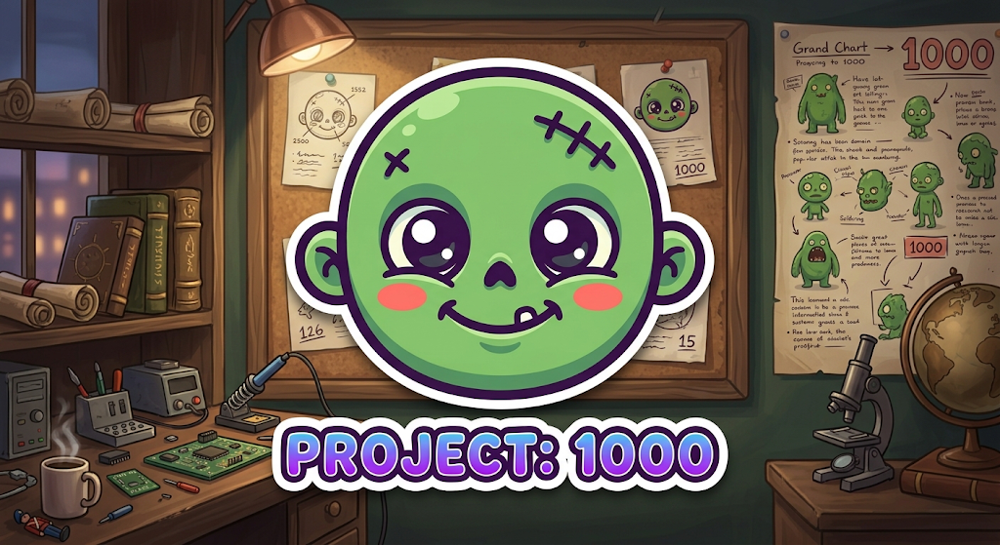

<p align="center">
  
</p>

# Project: 1000 — 1000 Things Before I Die

A private, offline bucket list and memory journal for Android and iOS.

Write down up to 1,000 things you want to do in your life, in the order
that means something to you. When you do them, attach memories (words,
photos, dates, places and hashtags). Over the years the list becomes a
record of your life.

There are no ads or tracking. Everything stays on your phone until you
export a backup yourself, unless you choose to sign in to an optional
Project: 1000 account to use your list on the website too.

**Author:** Cedrick Miguel P. Kaneko

---

## Features

- **Starts empty.** The list contains only what you write. There are no
  sample items or suggestions.
- **Up to 1,000 items**, each with a permanent number (`#001` … `#1000`).
- **Your order is never changed by the app.** Completing, editing,
  searching or filtering never moves an item. Order changes only when you
  reorder (drag, arrows, or "move to place…").
- **Completion with dates.** Choose the day you did it, past dates
  included. Un-completing keeps the old date on record.
- **Memories:** any number per item, each with optional title, text,
  date, location, hashtags and multiple photos.
- **Photos** are stored privately inside the app, with thumbnails and a
  full-screen swipe/zoom viewer.
- **Search** across numbers, titles, descriptions, memory text,
  locations and `#hashtags`; **filters** for All / Completed / Not
  completed.
- **Progress:** completed, remaining and percentage of 1,000.
- **Profile, EXP and levels.** Every completed thing is worth exactly
  1,000 EXP and every 10 things is a level, up to Level 100 at
  1,000 / 1,000. It is always calculated from the list, never stored or
  granted any other way, and it never affects the order.
- **Journeys.** Finishing all 1,000 things completes a journey. You
  choose when to archive it and begin the next (reusing your list or
  starting fresh). Every archived journey is kept in full, read-only.
- **Life Album** for each journey: your completed things and memories as
  a book, in your list's order, exportable as a PDF.
- **Backup & restore** to a single `.zip` file for moving to a new
  phone. Every file is checksum-verified before anything is replaced.
- **Light, dark or system theme.**

## Technology

| Part | Choice | Why |
|---|---|---|
| App framework | [Flutter](https://flutter.dev) (Dart) | One codebase for Android and iOS; compiles to native code; mature offline storage, file and image packages |
| Database | SQLite via `sqflite` | Transactional, reliable for decades, fast with thousands of rows |
| Photos | Files in the app's private folder; `image_picker` to choose, `image` for thumbnails | No permission prompts on modern Android (system photo picker) |
| Backup | `archive` (zip), `crypto` (SHA-256) | Portable, inspectable, verifiable |
| Life Album PDF | `pdf` | Pure Dart, runs offline in the background; fonts are bundled |

The full dependency list (all from [pub.dev](https://pub.dev)) is in
`pubspec.yaml`. None of them sends data anywhere.

## Project structure

```text
lib/
  data/        models, SQLite schema & migrations, repository, on-disk layout
  services/    photo storage, backup export/import, background work
  state/       app state (list in saved order, settings) and view filters
  ui/          screens, widgets, theme, user-facing error messages
test/          unit tests (run the real database code on desktop)
integration_test/  on-device UI and performance tests
tool/          prepare_branding.dart: icon images from the official logo
docs/          backup format, privacy, release process, cloud and web plans
supabase/      cloud backend: migrations (schema, security, API) and tests
design/        design tokens shared with the future web app
```

## Running locally

Requirements: [Flutter SDK](https://docs.flutter.dev/get-started/install)
(stable, 3.47 or newer), Android SDK with a device or emulator, and on
macOS, Xcode for iOS.

```bash
flutter pub get
flutter run                 # on a connected device/emulator
flutter test                # unit tests
flutter test integration_test/list_flow_test.dart   # on-device UI test
```

## Building

**Android**

```bash
flutter build apk --release --split-per-abi   # small APKs per CPU type
flutter build apk --release                   # one universal APK
flutter build appbundle --release             # .aab for Google Play
```

Release builds are signed with the key described in
[docs/RELEASING.md](docs/RELEASING.md). Without that key they are signed
with a debug key, which is fine for testing but not for distribution.

**iOS** (requires a Mac with Xcode and an Apple developer account)

```bash
flutter build ipa --release
```

See [docs/RELEASING.md](docs/RELEASING.md#ios) for what Apple requires.
An iOS build cannot simply be downloaded and installed on any iPhone.

## How your data is stored

Everything lives in the app's private storage, which other apps can't
read:

```text
archive/
  archive.db   SQLite database: items, memories, hashtags, photo records, settings
  photos/      your photos (resized to at most 2560 px, JPEG quality ~88)
  thumbs/      small thumbnails used in lists
```

Each item has a permanent unique ID, a permanent number and an explicit
position. All multi-step changes run in database transactions, so they
either happen completely or not at all. Deleting an item asks first, then
removes its memories and photos.

**Numbering:** a new item gets the lowest number not currently in use
(after you delete `#003`, the next new item becomes `#003`). It is
always added at the end of the list. Existing items are never
renumbered, and the list always stays within `#001`–`#1000`.

## Backup, restore and moving to a new phone

Settings → **Export backup** creates `1000-things-backup-YYYY-MM-DD-HHMM.zip`
with your whole archive. Keep it somewhere safe (computer, Google
Drive, iCloud, Dropbox). On Android you can save it straight to your
phone's storage; on iPhone use *Save to Files*.

On the new phone, install Project: 1000 and choose Settings → **Import
backup**. The app checks the backup completely (format, version, every
file's checksum, data consistency) before touching anything. Only then
does it ask to replace the current list. If anything goes wrong, even
if the app is closed mid-import, your existing list stays as it was.

The format is documented in [docs/BACKUP_FORMAT.md](docs/BACKUP_FORMAT.md).

## Privacy

No ads, no analytics, no tracking. Without an account the app makes
no network requests. With the optional account your data is in your
account only, readable by you alone. Details:
[docs/PRIVACY.md](docs/PRIVACY.md).

## Accounts, the website and Friends

The same app also runs in a web browser at https://1000-things.vercel.app,
and an optional account keeps one list in sync between devices:

- **Invite-only:** the owner approves an email, and the friend creates
  their own account with their own password.
- **Private per account,** enforced by the database: nobody, including
  the owner, can see anyone else's list, memories or photos, except
  what you choose to share with friends.
- **Optional on the phone:** without signing in, nothing changes. After
  signing in, "Connect this phone to my account" shows what will happen
  and then copies (or safely merges) the phone's list into the account,
  checks it, and uses it. The phone's own archive is never changed.
- **Live sync:** changes on the phone or the website appear on the other
  within seconds, and changes made offline are sent when the phone is
  back online.
- **Import and export on the website,** in the same backup format as the
  phone app.
- **Friends:** usernames, friend requests, and per-field sharing with
  everything off by default (see [docs/FRIENDS.md](docs/FRIENDS.md)).

The backend is in `supabase/`. Details are in
[docs/CLOUD.md](docs/CLOUD.md) and [docs/WEB_PLAN.md](docs/WEB_PLAN.md).
Releases up to 1.1.0 are fully offline.

## Known limitations

- **Importing on a phone without an account replaces its whole archive.**
  Importing into an account (website or signed-in phone) merges instead.
- **Large imports need free space.** For a short time an import needs
  roughly three times the backup's size: the file itself, the copy made
  when you pick it, and the unpacked archive.
- **No automatic backups.** Export regularly, especially before
  changing phones. On Android, the system's automatic cloud app-backup
  is disabled for privacy. On iPhone, app data is included in your
  device's own iCloud/computer backup if you have that turned on.
- **iOS has been configured but not yet built or tested on a real
  iPhone**, because that requires a Mac.
- Pinch-to-zoom in the photo viewer was not covered by automated tests.
- English only.

## Releases

See [docs/RELEASING.md](docs/RELEASING.md) and [CHANGELOG.md](CHANGELOG.md).
Android APKs are attached to
[GitHub Releases](https://github.com/cedishii/project-1000/releases).

## License

Source code: [MIT](LICENSE) © 2026 Cedrick Miguel P. Kaneko. The logo
and icon artwork are not covered by the MIT license (see `LICENSE`).
